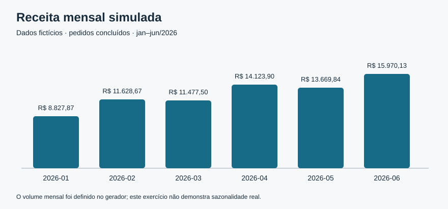

# Análise de vendas — demonstração

Projeto pessoal de estudo em análise de dados com **SQL, SQLite e Python**, usando uma operação fictícia de vendas de papelaria. Todos os dados são gerados por código; não há clientes, pessoas identificáveis ou registros de uma empresa real.

O objetivo é apresentar um fluxo reproduzível: gerar dados, organizar um modelo relacional, consultar indicadores e explicar os resultados e suas limitações.

## Perguntas da análise

- Como a receita das vendas concluídas se distribui ao longo dos meses?
- Quais canais, categorias e produtos concentram essa receita?
- Qual é o ticket médio por pedido concluído?
- Qual é a margem bruta simulada, considerando apenas o custo dos produtos?
- Qual é a proporção de pedidos cancelados?

As respostas geradas estão em [Resultados da análise](docs/resultados.md). A evolução mensal também é apresentada no gráfico abaixo.



## Dados e modelo

A demonstração cobre janeiro a junho de 2026 e possui 760 pedidos, 12 produtos e três canais: `loja_online`, `marketplace` e `loja_fisica`. A base utiliza uma semente fixa (`42`) para permitir a reprodução dos dados.

O modelo contém três tabelas:

| Tabela | Conteúdo | Relação |
| --- | --- | --- |
| `produtos` | Identificação, descrição e categoria dos produtos fictícios | Um produto pode aparecer em vários itens |
| `pedidos` | Data, canal e situação de cada pedido | Um pedido possui um ou mais itens |
| `itens_pedido` | Produto, quantidade, preço, custo e desconto de cada item | Cada item pertence a um pedido e referencia um produto |

Os valores monetários são armazenados como **centavos inteiros**, evitando o uso de números de ponto flutuante para somar dinheiro. Consulte o [dicionário de dados](docs/dicionario-dados.md) para as definições dos campos.

## Como executar

Requisito: **Python 3.10 ou superior**. O projeto utiliza apenas a biblioteca padrão; não exige instalação de pacotes, conta em serviço externo ou conexão com uma base remota.

Na pasta do projeto, execute:

```bash
python scripts/gerar_dados.py
python scripts/analisar.py
python scripts/gerar_dados.py --verificar
```

O primeiro comando gera a base SQLite local e os arquivos CSV. O segundo executa as seis consultas e atualiza o relatório e o gráfico em `docs/`. O terceiro compara os arquivos e as tabelas com uma nova geração em memória, sem regravá-los. Para reproduzir a análise, mantenha os parâmetros de geração definidos no código.

Os CSVs e os resultados de demonstração são versionados para facilitar a leitura. O arquivo `data/demo.sqlite` é gerado localmente e fica fora do versionamento.

Na execução da análise, o script verifica a integridade do banco e concilia os totais calculados em SQL com cálculos independentes em Python sobre os CSVs.

## Definição dos indicadores

| Indicador | Regra utilizada |
| --- | --- |
| Receita líquida de descontos | Soma de `quantidade × preço unitário − desconto do item`, apenas para pedidos concluídos |
| Custo dos produtos | Soma de `quantidade × custo unitário`, apenas para pedidos concluídos |
| Resultado bruto simulado | Receita líquida de descontos menos custo dos produtos |
| Margem bruta simulada | Resultado bruto simulado dividido pela receita líquida de descontos |
| Ticket médio | Receita líquida de descontos dividida pelo número de pedidos concluídos distintos |
| Taxa de cancelamento | Número de pedidos cancelados dividido pelo número total de pedidos |

Pedidos cancelados participam da análise de cancelamentos, mas não compõem receita, custo ou ticket médio. O número de itens não é utilizado como denominador do ticket.

## Organização

```text
data/                    CSVs sintéticos e base SQLite gerada localmente
docs/                    Dicionário, resultados e gráfico
scripts/gerar_dados.py    Geração reproduzível dos dados
scripts/analisar.py       Execução das consultas e produção dos resultados
sql/schema.sql           Estrutura do banco e regras de integridade
sql/analises.sql          Consultas da análise
```

## Limitações e interpretação

- As distribuições e os valores foram escolhidos para uma demonstração. Os resultados não descrevem uma operação real nem comprovam tendências de mercado.
- A margem é uma simulação que considera apenas o custo dos produtos. Fretes, tributos, taxas de canal, despesas operacionais e devoluções não estão modelados; portanto, ela não representa lucro líquido.
- A comparação entre canais e produtos é descritiva. A base não permite concluir causalidade nem avaliar clientes, pois não contém cadastro de clientes.
- Os seis meses são um recorte fechado. O projeto não implementa previsão de vendas.

## Autoria e uso de IA

Este é um projeto de estudo de Natan, estruturado com apoio de inteligência artificial na elaboração do código e da documentação. O repositório é uma demonstração com dados sintéticos e não apresenta resultados de uma operação real.

## Licença

O código, a documentação e os dados sintéticos originais deste projeto estão disponíveis sob a [licença MIT](LICENSE).
