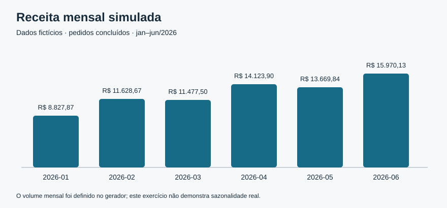

# Resultados da análise demonstrativa

> Dados inteiramente fictícios, gerados com seed 42. Não representam uma empresa, clientes ou resultados profissionais reais.

Este relatório é gerado por `python scripts/analisar.py`, após a execução das consultas em `sql/analises.sql` e a conciliação independente em Python.

## Escopo e qualidade

Período: janeiro a junho de 2026. Base com **760 pedidos**, **1901 itens de pedido** e **12 produtos**. Há **52 pedidos cancelados** (6,8% dos pedidos), excluídos da receita e do custo.

Verificações concluídas: integridade SQLite, chaves estrangeiras, pedidos com itens, igualdade dos CSVs com o banco e conciliação dos totais e agrupamentos SQL/Python.

## Indicadores

| Indicador | Resultado |
| --- | --- |
| Pedidos concluídos | 708 |
| Unidades em pedidos concluídos | 4431 |
| Valor bruto antes de descontos | R$ 78.067,03 |
| Descontos | R$ 2.369,12 |
| Receita após descontos | R$ 75.697,91 |
| Custo simulado dos produtos | R$ 35.690,79 |
| Margem bruta simulada — valor | R$ 40.007,12 |
| Margem bruta simulada — percentual | 52,9% |
| Ticket médio por pedido concluído | R$ 106,92 |

## Evolução mensal

| Mês | Pedidos concluídos | Receita | Ticket médio | Margem bruta simulada |
| --- | --- | --- | --- | --- |
| 2026-01 | 86 | R$ 8.827,87 | R$ 102,65 | 53,1% |
| 2026-02 | 104 | R$ 11.628,67 | R$ 111,81 | 52,9% |
| 2026-03 | 113 | R$ 11.477,50 | R$ 101,57 | 52,9% |
| 2026-04 | 119 | R$ 14.123,90 | R$ 118,69 | 52,6% |
| 2026-05 | 131 | R$ 13.669,84 | R$ 104,35 | 53,1% |
| 2026-06 | 155 | R$ 15.970,13 | R$ 103,03 | 52,6% |

## Canais

| Canal | Pedidos concluídos | Receita | Participação na receita |
| --- | --- | --- | --- |
| loja_fisica | 242 | R$ 25.354,59 | 33,5% |
| loja_online | 232 | R$ 25.327,36 | 33,5% |
| marketplace | 234 | R$ 25.015,96 | 33,0% |

## Categorias

| Categoria | Unidades | Receita | Margem bruta simulada |
| --- | --- | --- | --- |
| Organizacao | 1457 | R$ 39.737,43 | 51,1% |
| Escritorio | 1463 | R$ 21.018,49 | 54,2% |
| Papelaria | 1511 | R$ 14.941,99 | 55,7% |

Um pedido pode conter várias categorias. Contagens de pedidos por categoria não devem ser somadas para obter o total de pedidos.

## Cinco produtos com maior receita

| Produto | Unidades | Receita |
| --- | --- | --- |
| Organizador de mesa | 373 | R$ 14.853,42 |
| Caixa organizadora | 369 | R$ 12.017,27 |
| Grampeador pequeno | 357 | R$ 9.221,96 |
| Estojo simples | 324 | R$ 7.038,29 |
| Caderno A5 liso | 364 | R$ 6.908,87 |

## Leituras do exercício

- **2026-06** apresenta a maior receita simulada: R$ 15.970,13, com 155 pedidos concluídos. O número de pedidos por mês foi definido no gerador; esse desenho impede interpretar a evolução como sazonalidade de um negócio real.

- **loja_fisica** concentra 33,5% da receita simulada. A comparação é descritiva e não mede a eficiência do canal: não há gastos de aquisição, frete ou taxas de plataforma na base.

- **Organizador de mesa** tem a maior receita entre os produtos (R$ 14.853,42). Esse ranking não demonstra preferência de clientes, pois produtos, quantidades e preços foram sorteados pelo gerador.

## Limitações

A margem bruta simulada considera apenas receita após desconto menos custo dos produtos. Não representa lucro líquido: tributos, frete, despesas fixas, taxas de plataforma, devoluções e diferenças de prazo não estão modelados. O custo registrado em pedidos cancelados não é reconhecido na análise; não há perdas ou custos de cancelamento. Não existem clientes, identificação pessoal, estoque ou metas. As conclusões servem para demonstrar consultas e conciliação, sem orientar decisões reais.
